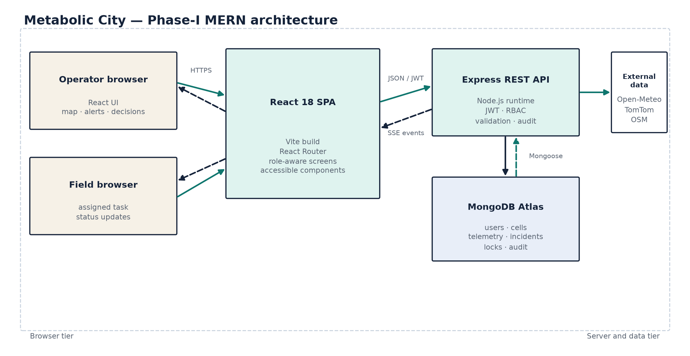
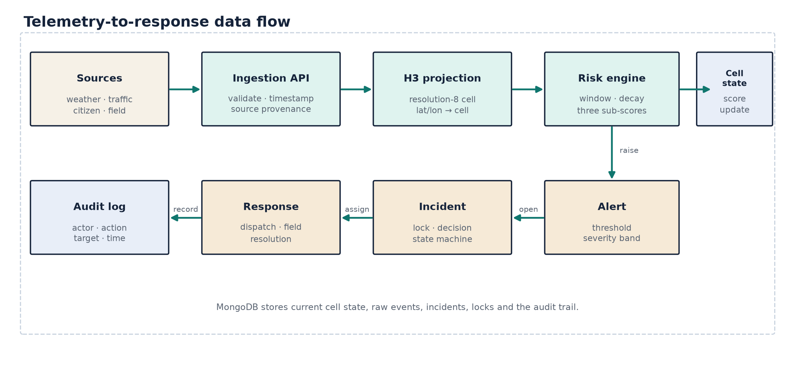
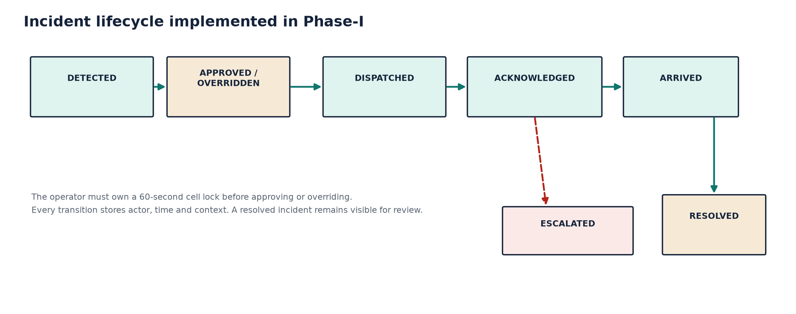
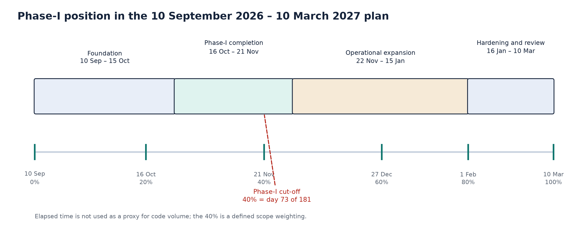
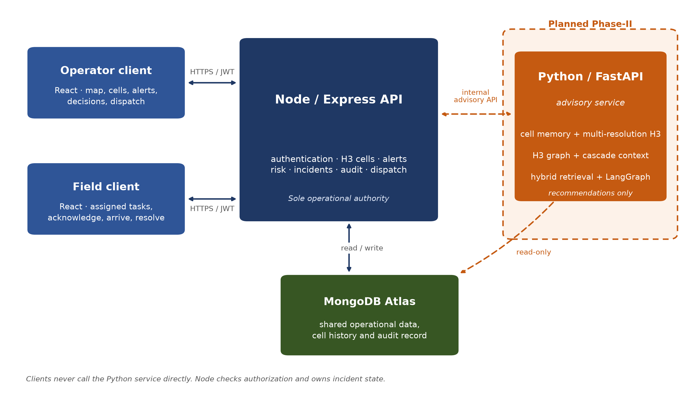

# Metabolic City

## A MERN-Based Urban Risk and Incident Response Platform

**An Engineering Project in Community Service**

**Phase-I Report**

Submitted by

| Sl. No. | Register Number | Name |
| --- | --- | --- |
| 1 | [Register Number] | [Team Member 1] |
| 2 | [Register Number] | [Team Member 2] |
| 3 | [Register Number] | [Team Member 3] |
| 4 | [Register Number] | [Team Member 4] |
| 5 | [Register Number] | [Team Member 5] |
| 6 | [Register Number] | [Team Member 6] |

in partial fulfillment of the requirements for the degree of

**Bachelor of Technology / Integrated Master of Technology**

**VIT Bhopal University**
Bhopal
Madhya Pradesh

**November 2026**

<!-- pagebreak -->

# Bonafide Certificate

Certified that this project report titled **“Metabolic City: A MERN-Based Urban Risk and Incident Response Platform”** is the bonafide work of **[Team Member 1, Register Number], [Team Member 2, Register Number], [Team Member 3, Register Number], [Team Member 4, Register Number], [Team Member 5, Register Number] and [Team Member 6, Register Number]**, who carried out the project work under my supervision.

This project report (Phase I) is submitted for the Project Viva-Voce examination held on ____________________.

   

____________________
**Supervisor**

   

____________________
**Comments and Signature (Reviewer 1)**

   

____________________
**Comments and Signature (Reviewer 2)**

<!-- pagebreak -->

# Declaration of Originality

We hereby declare that this report entitled **“Metabolic City: A MERN-Based Urban Risk and Incident Response Platform”** represents our original work carried out for the EPICS project as students of VIT Bhopal University. To the best of our knowledge, it contains no material previously published or written by another person, nor any material presented for the award of any other degree or diploma of VIT Bhopal University or any other institution. Works of other authors cited in this report have been duly acknowledged under the section **References**.

Date: ____________________

| Register Number | Name | Signature |
| --- | --- | --- |
| [Register Number] | [Team Member 1] | |
| [Register Number] | [Team Member 2] | |
| [Register Number] | [Team Member 3] | |
| [Register Number] | [Team Member 4] | |
| [Register Number] | [Team Member 5] | |
| [Register Number] | [Team Member 6] | |

<!-- pagebreak -->

# Acknowledgement

We express our sincere gratitude to our project supervisor for guidance on scope, review discipline and engineering documentation. We thank the reviewers for their time and for insisting that every claim in this report be tied to something that can be demonstrated.

We are grateful to the faculty and staff of VIT Bhopal University for providing the academic environment in which this work was carried out. We also acknowledge the open-source communities behind Node.js, Express, React, MongoDB, H3, Leaflet and the other libraries used in the implementation. Their documentation and public source code made a small, reproducible municipal prototype possible.

Finally, we thank the municipal officials and field respondents who shared their operational context during the problem-discovery and survey stages. Their descriptions of fragmented reporting, delayed escalation and unclear ownership shaped the workflow that this Phase-I implementation begins to address.

<!-- pagebreak -->

# Abstract

Urban operations in Bhopal, Indore and Sehore are distributed across departments, spreadsheets, telephone calls and separate reporting channels. A road blockage, a waterlogging point and a citizen complaint may describe the same place, but they rarely arrive in one operational view. The result is delayed escalation, duplicate inspection and weak accountability. Metabolic City addresses this problem as a web-based urban risk and incident response platform built on the MERN stack: MongoDB Atlas for persistent operational data, Express and Node.js for the API, and React for the role-aware user interface.

The platform converts weather, traffic, terrain, citizen and field inputs into a shared spatial view. Each observation is projected to a resolution-8 H3 cell, scored on mobility, climate and vulnerability, and combined into a composite risk value. Sustained risk produces an alert; an operator can examine the cell, acquire a short-lived lock, approve or override the recommendation, and open an incident. The incident then moves through dispatch, acknowledgement, arrival and resolution, with an audit record for each decision. The interface is deliberately split by role: operators see the city grid and response queue, field crews see assigned work, and administrators manage users and risk weights.

This Phase-I report covers a controlled 40% implementation baseline. The project runs from 10 September 2026 to 10 March 2027, a span of 181 days. The 40% milestone falls 72.4 days after the start, on 21 November 2026. This report therefore claims the foundation, authentication, data layer, telemetry-to-cell path, core risk engine, operator console and core incident lifecycle. It does not claim the later field-operations expansion, full administrative analytics, large-scale testing or production deployment. Those remain part of the final 60%.

The Phase-I system is a working local prototype, not a municipal deployment. Its contribution is an evidence-aware MERN architecture in which spatial state, operator decisions and accountability are connected in one auditable loop. The report also states the limits of the present evidence so that later phases can be evaluated against a clear baseline rather than against inflated claims.

**Keywords:** urban risk management; MERN stack; H3 spatial indexing; incident response; role-based access control; MongoDB; React

<!-- pagebreak -->

# Index

<!-- toc -->

<!-- pagebreak -->

# List of Figures

<!-- list-of-figures -->

<!-- pagebreak -->

# List of Tables

<!-- list-of-tables -->

<!-- pagebreak -->

# 1. Introduction

Urban infrastructure failures rarely remain within one department. A blocked drain can flood a road, a flooded road can delay an ambulance, and a delayed ambulance can become a public complaint. Yet the information needed to connect these events is usually held in separate systems. Municipal staff receive reports by telephone, messaging groups, inspection notes and paper registers; field crews receive instructions verbally; and supervisors reconstruct what happened only after the event. The cost is not only delay. It is also the loss of a reliable record of who decided what, when and on what evidence.

Metabolic City is a response to that operational gap. It is a browser-based platform that maintains a live spatial picture of a city, converts incoming observations into risk at the neighbourhood scale, and connects that risk to a controlled incident workflow. The system is built on the MERN stack: MongoDB Atlas, Express, React and Node.js. The choice is deliberate. A single language across the browser and server reduces the cost of a student-built system; a document database accommodates heterogeneous urban observations; and a component-based React interface can present different workflows to operators, field crews and administrators without duplicating the entire application.

The project is being delivered in two phases. Phase I, the subject of this report, establishes the foundation and the core operational loop. Phase II extends the platform into field operations, administrative analytics, broader validation and deployment. The Phase-I boundary is intentionally modest. The report describes a 40% implementation baseline, not the complete project, and it avoids claims that belong to later work. This is important for an engineering report: a prototype that demonstrates one reliable loop is more useful than a larger system whose behaviour has not been verified.

The geographical focus is Bhopal, with Indore and Sehore represented in the data model and pilot configuration. The platform uses resolution-8 H3 cells, which provide a consistent spatial unit for joining observations that arrive at different scales. Weather may be available for a city, traffic for a road segment, and a citizen report for a single point; all three can be projected to the same cell and evaluated together. This shared unit is the technical basis for the operational view.

The Phase-I contribution is fourfold. First, it defines an operational data model for users, spatial cells, telemetry events, alerts, incidents, field tasks, locks and audit records. Second, it implements a role-based MERN application in which the browser never receives database credentials and every protected action is authorised on the server. Third, it implements a deterministic telemetry-to-risk path with an explicit scoring formula and a visible distinction between measured, interpolated and unavailable inputs. Fourth, it implements an operator incident workflow with a time-bounded cell lock, approval or override, dispatch, field acknowledgement and resolution.

The remainder of the report is organised as follows. Section 2 states the motivation. Section 3 defines the objective and the Phase-I boundary. Section 4 reviews the relevant literature and existing practice. Section 5 presents the system design and architecture. Section 6 explains the working principle, including the risk formula and incident state machine. Section 7 defines the 40% milestone and the work packages included in Phase I. Section 8 reports the verification results and discusses limitations. Section 9 records individual contributions, and Section 10 concludes.

<!-- pagebreak -->

# 2. Motivation

The motivation for this work comes from a practical asymmetry. Cities generate a large amount of operational signal, but small municipal teams have limited capacity to turn that signal into coordinated action. The problem is not a shortage of data alone. It is the absence of a shared operational object that staff can act on, annotate and hand over. A list of complaints is not an incident. A weather warning is not a dispatch decision. A risk score is not accountability. The platform is designed to bridge those gaps without pretending that software can replace municipal judgement.

The first motivation is **spatial fragmentation**. A citizen report is a point, a traffic observation is a road segment, a weather forecast is a city-level grid, and an administrative boundary is a polygon. Without a common spatial unit, staff must reconcile these layers mentally. H3 provides a hierarchical, globally consistent cell system that can join them at a chosen resolution [6], [7]. Resolution 8 is small enough to distinguish neighbouring streets and large enough to avoid presenting false precision at the level of a single address.

The second motivation is **temporal fragmentation**. A single high reading may be noise; a sustained pattern is operationally meaningful. The Phase-I risk engine therefore evaluates observations over a one-hour window and applies a thirty-minute decay half-life. This is a simple, explainable rule rather than a learned model. The purpose is to give staff a defensible summary while keeping the raw event history available for review.

The third motivation is **accountability**. In an emergency, several people may believe that someone else has taken ownership. A shared screen does not solve that problem unless the system records a decision. Phase-I therefore introduces a short-lived cell lock and an append-only audit trail. The lock prevents two operators from making conflicting decisions at the same moment; the audit trail preserves the decision after the moment has passed. This is a modest but important form of digital accountability.

The fourth motivation is **role-appropriate access**. An operator needs the city grid and the decision queue. A field crew needs the assigned task, the location and the resolution note, not the entire city risk model. An administrator needs user and threshold controls. A single interface with hidden buttons is not sufficient; authorisation must be enforced at the API. The Phase-I implementation therefore uses separate role checks on the server and role-aware routes in the client.

Finally, the project is motivated by **reproducibility**. A student project can easily become a demonstration that works only on one laptop with undocumented data. The Phase-I design instead keeps the data model, scoring formula, API contracts and verification steps explicit. The local configuration is documented, and external data sources are accessed through server-side adapters. This makes the prototype easier to review, criticise and extend.

<!-- pagebreak -->

# 3. Objective

The overall objective is to design and implement a role-based MERN platform that converts heterogeneous urban observations into a shared spatial risk view and a controlled incident response workflow.

The specific objectives of Phase I are:

- To define a MongoDB data model for users, spatial cells, telemetry events, alerts, incidents, field tasks, cell locks and audit records.
- To implement secure authentication and role-based authorisation for operators, field crews and administrators.
- To implement an ingestion path that validates observations, preserves source context and projects each observation to a resolution-8 H3 cell.
- To implement a deterministic risk engine that computes mobility, climate and vulnerability scores and combines them into a composite risk value.
- To implement an operator console that presents the live cell grid, alerts, cell detail, action guidance and incident history.
- To implement an incident lifecycle with a time-bounded lock, approval or override, dispatch, acknowledgement, arrival and resolution.
- To verify the Phase-I baseline through role-based end-to-end checks, API checks and a production frontend build.
- To document the boundary between the 40% Phase-I baseline and the remaining 60% of the project.

The Phase-I scope excludes several capabilities that are often assumed in a smart-city demonstration. It does not claim a live municipal data feed, a city-wide deployment, a trained prediction model, a mobile offline application, a complete analytics suite or a production service-level agreement. These exclusions are deliberate. They keep the report aligned with what has actually been implemented and verified at the 40% milestone.

<!-- pagebreak -->

# 4. Existing Work and Literature Review

## 4.1 Urban computing and the real-time city

Urban computing studies how large-scale, heterogeneous data from cities can be used to understand and improve urban systems [1]. Batty argues that cities can be understood as complex systems whose behaviour emerges from many local interactions rather than from a single central controller [2]. Kitchin extends this argument to the real-time city, where digital data streams create new possibilities for management but also new risks of dashboards that appear objective while hiding their assumptions [3]. These works inform a central design choice in Metabolic City: the platform presents a spatial summary, but it also exposes the source and quality of the evidence behind that summary.

Urban resilience research emphasises that resilience is not only the ability to absorb a shock but also the capacity to reorganise, learn and adapt [4]. A useful operational platform therefore needs more than a map. It needs a record of decisions, a way to hand work from one role to another, and a mechanism for reviewing what happened. The incident lifecycle and audit trail in Phase-I are a small implementation of that idea.

## 4.2 GIS, spatial indexing and H3

Geographic information systems provide the traditional toolkit for spatial analysis: coordinate systems, layers, buffers, joins and network analysis [5]. A conventional GIS is powerful, but it often assumes a trained analyst and a desktop workflow. A web platform needs a spatial index that is cheap to compute in the browser and on the server, consistent across datasets, and stable enough to serve as a database key.

H3 is a hierarchical hexagonal spatial index developed by Uber [6], [7]. It partitions the world into hexagonal cells at multiple resolutions and provides functions for converting coordinates to cells, finding neighbours, and moving between parent and child resolutions. Hexagons reduce some of the edge effects associated with square grids and provide a more uniform neighbourhood relation. For this project, the practical advantage is simpler: a latitude and longitude pair can be converted to a short string that is indexed in MongoDB and used consistently by the API, the map and the frontend.

GeoJSON provides a standard representation for the resulting point geometry [8]. The Phase-I implementation stores both the H3 index and a GeoJSON point, with a 2dsphere index for nearby queries. This combines the operational convenience of H3 with the query capability of MongoDB's geospatial index.

## 4.3 Web architecture and the MERN stack

Representational State Transfer (REST) remains a useful architectural style for a browser-based operational system because it separates resources, representations and actions [9], [10]. The Phase-I API follows a resource-oriented structure: authentication under `/api/auth`, telemetry under `/api/v1/telemetry`, cells under `/api/v1/spatial-cells`, incidents under `/api/v1/incidents`, field work under `/api/v1/field`, and administration under `/api/v1/admin`.

The MERN stack combines MongoDB, Express, React and Node.js. Node.js provides an event-driven JavaScript runtime [11]; Express provides a small HTTP routing layer [12]; React provides a component model for the interface [13]; Vite provides a fast development and production build [14]; and MongoDB provides a document store with flexible schemas and secondary indexes [15], [16], [17]. The stack is not a substitute for architecture, but it reduces the number of languages and build systems a small team must maintain.

A document database is a reasonable fit for urban telemetry because observations from different sources have different fields. A weather event carries rainfall, visibility and wind; a traffic event carries speed, delay and road segment; a citizen report carries text, image references and a point. MongoDB allows these to share a collection or be separated by source while retaining a common timestamp and spatial key. Mongoose adds schema validation and indexes at the application boundary [15], [17].

## 4.4 Real-time operational interfaces

Operational interfaces have different requirements from marketing pages. The user is monitoring a changing state, making decisions under time pressure, and handing work to another person. The interface must show what changed, what is uncertain, and what action is available. Server-Sent Events (SSE) provide a simple one-way stream from the server to the browser, which is sufficient for cell and alert updates in Phase-I. The alternative, a full publish-subscribe WebSocket layer, adds operational complexity that is not justified at this stage.

The design of the operator console follows established usability principles: visibility of system status, clear mapping between the map and the cell list, and feedback after an action [25], [26]. Accessibility guidance influenced the use of semantic controls, keyboard focus and text labels rather than colour alone [23], [24]. The console does not claim full WCAG conformance; it records accessibility as a design consideration and a later verification item.

## 4.5 Security and role-based access

An operational platform holds personal data, location data and decision records. The relevant security guidance is therefore broader than password hashing. OWASP's Top Ten and Application Security Verification Standard provide a practical baseline for authentication, access control, input validation, logging and error handling [20], [21]. NIST SP 800-63B provides guidance on credential length, rate limiting and authentication feedback [22]. The JWT specifications define the token format and a set of best practices for validation [18], [19].

Phase-I applies these ideas in a modest way: bcrypt password hashing, short-lived access tokens, rotating refresh tokens, server-side session records, role checks on protected routes, request validation, rate limiting on authentication endpoints, Helmet headers, a strict CORS allow-list and audit logging. The platform does not claim to be certified or production-hardened. The point is to make the security boundary explicit and testable.

## 4.6 Software architecture and data-intensive systems

The architecture literature distinguishes between logical structure, process view, deployment view and quality attributes [29]. A small system still benefits from this discipline. The Phase-I architecture separates the browser application, the HTTP API, the domain services, the persistence layer and the external data adapters. This separation makes it possible to test the risk formula without a browser and to replace a data provider without rewriting the UI.

Data-intensive systems guidance emphasises reliability, scalability and maintainability as separate concerns [28]. The project addresses reliability through retries and degraded states, scalability through indexed queries and pagination, and maintainability through modular routes, shared utilities and explicit contracts. It does not claim that a single local instance is scalable; it documents the choices that would need to change before a production claim could be made.

Classic design patterns and integration patterns also shaped the implementation [32], [33]. The incident lifecycle is a state machine, the external data adapters isolate provider-specific behaviour, and the audit middleware records actions at the boundary. These are small applications of established patterns rather than novel contributions.

## 4.7 Research and practice gap

The literature offers strong accounts of urban data, spatial indexing, web architecture and security. It offers less guidance on how a small municipal team can move from a risk signal to an accountable response using an affordable web stack. Commercial command-and-control products exist, but they are often expensive, closed and difficult to adapt to a student project or a small municipality. A simple open prototype that connects spatial risk, human decision, field work and audit is therefore a useful applied contribution.

The gap addressed by Phase-I is not the invention of a new risk model. It is the integration of a small number of established ideas into one operational loop that can be demonstrated, criticized and extended. The report is explicit about what the loop does and does not prove.

<!-- pagebreak -->

# 5. System Design and Architecture

## 5.1 Design goals

The architecture was shaped by five goals:

- **One spatial language.** Every observation that has a location should resolve to an H3 cell that can be stored, indexed and displayed consistently.
- **One operational record.** A risk signal, an operator decision and a field update should refer to the same incident rather than to disconnected notes.
- **Role-appropriate surfaces.** Operators, field crews and administrators should see the information and actions relevant to their work.
- **Evidence before presentation.** The interface should distinguish measured values from interpolated values and missing values.
- **A reviewable boundary.** Every external integration should pass through a server-side adapter so that credentials and provider behaviour remain outside the browser.

These goals are deliberately narrower than the full project vision. They define the 40% baseline in terms of qualities that can be checked, not in terms of the number of screens.

## 5.2 Architecture overview

**Figure 1.** Phase-I MERN architecture, showing the browser tier, the Express API, MongoDB Atlas and server-side external data adapters.

The browser tier contains the role-aware React application. It is a single-page application built with Vite and React Router. The operator and field surfaces share authentication, layout primitives and API utilities but have different routes and navigation. The browser never connects directly to MongoDB and never holds a database credential.

The server tier is an Express application running on Node.js. It exposes REST endpoints for authentication, telemetry, spatial cells, incidents, field tasks, alerts, administration and audit. It validates input, checks the authenticated user's role, calls domain services and persists state through Mongoose models. The server also owns the external data adapters for weather, traffic and map context. Provider keys remain in environment variables on the server.

MongoDB Atlas stores the operational state. The principal collections are users, spatial cells, telemetry events, alerts, incidents, cell locks, field tasks and audit records. The spatial cell collection stores the H3 index, the GeoJSON point, the three sub-scores, the composite risk, the risk band, the alert summary, the forecast summary and a bounded history. The incident collection stores the cell, the risk at detection, the operator decision, the assigned crew, the state timestamps and the resolution note.

The architecture is intentionally a modular monolith. A separate service for every domain would add deployment and debugging cost without a demonstrated need at this scale. The route and service boundaries are clear enough that a domain could be extracted later if measurement justified it [27], [29].

## 5.3 Technology choices

| Layer | Technology | Role in Phase-I | Reason |
| --- | --- | --- | --- |
| Interface | React 18, Vite, React Router | Role-aware operator and field surfaces | Component reuse, route-level code splitting, fast build |
| Styling | CSS modules and design tokens | Consistent layout, theme and responsive states | Local scope, no runtime CSS dependency |
| API | Node.js, Express | REST endpoints, validation, authorisation, SSE | One language across stack, small operational surface |
| Data | MongoDB Atlas, Mongoose | Operational collections, indexes, geospatial queries | Flexible observation shape, secondary indexes |
| Spatial | H3-js | Coordinate-to-cell projection and neighbours | Stable hierarchical cell key |
| Maps | Leaflet, OpenStreetMap tiles | Cell map and location context | Lightweight browser mapping |
| Charts | Recharts | Operator trend and risk summaries | Declarative React charts |
| Authentication | JWT, bcrypt, HTTP-only refresh cookie | Access and refresh sessions | Stateless request authentication with revocable session records |

The stack is conventional on purpose. A novel stack would add risk without improving the core research question. The engineering effort is concentrated in the data model, the risk path and the workflow.

## 5.4 Data model

| Collection | Key fields | Purpose |
| --- | --- | --- |
| `users` | name, email, role, cityCode, staffId/phone/adminId, password hash | Identity and role-specific login |
| `tokensessions` | jti, userId, expiresAt | Revocable access and refresh sessions |
| `spatialcells` | h3Index, location, scores, weights, compositeRisk, riskLevel, alerts, forecast, history | Current spatial state |
| `telemetryevents` | source, h3Index, observedAt, payload, provenance | Raw observations and evidence |
| `alerts` | h3Index, type, severity, status, firstSeen, lastSeen | Operational alert lifecycle |
| `incidents` | h3Index, riskScore, action, status, operatorId, assignedCrewId, timestamps | Decision and response record |
| `celllocks` | h3Index, lockOwnerId, expiresAt | Short-lived operator concurrency control |
| `auditlogs` | userId, action, method, path, target, createdAt | Accountability trail |

The spatial cell is the join point. A telemetry event carries the H3 index it contributed to; an alert carries the cell it belongs to; an incident carries the cell and the risk snapshot at detection. This makes it possible to reconstruct why a cell was considered risky without scanning every event on each page load.

The user model separates login identifiers by role. An operator logs in with a staff ID, a field crew member with a registered phone number, and an administrator with an admin ID. All three also have an email and a password hash. This matches the operational language used in the municipal workflow and avoids pretending that every role has the same identity process.

## 5.5 API design

| Endpoint group | Representative routes | Access |
| --- | --- | --- |
| Authentication | `POST /api/auth/login`, `POST /api/auth/refresh`, `POST /api/auth/logout`, `GET /api/auth/me` | Public or authenticated |
| Telemetry | `POST /api/v1/telemetry/weather`, `POST /api/v1/telemetry/transit`, `POST /api/v1/telemetry/citizen` | Service or authenticated |
| Cells | `GET /api/v1/spatial-cells`, `GET /api/v1/spatial-cells/:h3Index` | Operator, administrator |
| Incidents | `GET /api/v1/incidents`, `POST /api/v1/incidents/:h3Index/lock`, `POST /api/v1/incidents/:h3Index/decision`, `POST /api/v1/incidents/:id/dispatch` | Operator, administrator |
| Field | `GET /api/v1/field/tasks`, `POST /api/v1/field/tasks/:id/status` | Field crew, operator, administrator |
| Stream | `GET /api/v1/stream/h3` | Authenticated |
| Administration | `GET /api/v1/admin/weights`, `PUT /api/v1/admin/weights`, `GET /api/v1/admin/users` | Administrator |

The API returns explicit error states rather than silently substituting data. A missing weather source produces a degraded cell, not a zero-rainfall claim. A failed lock produces a conflict response with the current owner, not a second incident. An invalid role produces a forbidden response at the server even if the client route was manipulated.

## 5.6 Security architecture

Phase-I applies a defence-in-depth approach [20], [21]:

- **Transport and headers.** Helmet sets security headers; CORS is restricted to the configured frontend origins.
- **Authentication.** Passwords are hashed with bcrypt; access tokens are short-lived; refresh tokens are stored in an HTTP-only, SameSite cookie and tracked in a server-side session collection.
- **Authorisation.** Each protected route declares the roles that may use it. The role is read from the verified token, not from a client-supplied field.
- **Input validation.** Express-validator checks required fields, formats, lengths and enumerations before the route handler runs.
- **Rate limiting.** Authentication endpoints have a stricter limiter than the general API.
- **Audit.** The audit middleware records the actor, action, method, path, target and timestamp for protected actions.
- **Error handling.** Centralised error handling avoids returning stack traces to the browser.

The design does not claim that these controls are sufficient for a public municipal deployment. It claims that the controls are present, testable and appropriate for a local Phase-I prototype. A production review would add dependency scanning, penetration testing, secret rotation, backup restoration drills and a formal incident-response plan.

## 5.7 Deployment topology

The Phase-I topology is a local three-process development setup: the Express API on port 5000, the Vite development server on port 5173 and MongoDB Atlas as the managed database. The browser loads the React application from the Vite server and calls the API at `localhost:5000`. The API connects to Atlas over TLS. Weather and traffic providers are called from the server, not from the browser.

This topology is simple enough to reproduce and small enough to debug. It is not a production topology. A later phase would place the API behind a managed reverse proxy, serve the built React assets from a static host or CDN, configure a restrictive production CORS list, enable centralised logging and add health-based restarts.

## 5.8 Design trade-offs

Three trade-offs are worth recording. First, a modular monolith was preferred over microservices because the team is small and the operational load is not yet measured [27]. Second, a deterministic risk formula was preferred over a learned model because the formula can be explained to an operator and tested without a training pipeline. Third, a single MongoDB cluster was preferred over a sharded deployment because the Phase-I data volume does not justify sharding and the added complexity would obscure the workflow being studied.

These choices are not claims of permanent correctness. They are appropriate for the 40% baseline and are revisited in the remaining 60%.

<!-- pagebreak -->

# 6. Working Principle

## 6.1 Telemetry ingestion

**Figure 2.** Telemetry-to-response data flow from source observation to spatial state, alert, incident and audit.

The ingestion path begins with a source-specific request. A weather adapter sends rainfall, visibility and wind; a traffic adapter sends speed, delay and road context; a citizen report sends a point, text and optional evidence; a field report sends a task reference and a status update. The API validates the request, attaches the source and observation time, and passes it to the risk engine.

The engine converts the observation's latitude and longitude to a resolution-8 H3 cell. It then stores a telemetry event with the cell index and source context. The raw event is retained so that a later review can distinguish what was measured from what was inferred. The cell's current state is updated from the event window rather than from the single latest event.

A key design rule is that missing data is not replaced by a believable zero. If a cell has no mobility observation, the mobility score is marked as unavailable or degraded rather than treated as free-flow traffic. If a weather provider fails, the cell can use a recent observation with an explicit age, or it can show a degraded state. This rule is more important than any particular formula because it prevents the interface from presenting false confidence.

## 6.2 H3 projection and spatial state

H3 resolution 8 is the operational unit for Phase-I. At this resolution, a cell is small enough to distinguish neighbouring streets in the pilot area and large enough to avoid claiming address-level precision [6]. The cell record stores its centre coordinates, its H3 index, its GeoJSON point and its city code. The GeoJSON point supports nearby queries through a 2dsphere index [8], [15].

The cell record is a materialised view. It is derived from telemetry events, but it is stored separately so that the operator console can load a city grid without recomputing the entire history. The record contains a bounded history of recent scores, which supports the trend display and the forecast. The history is intentionally bounded; an unbounded array inside a frequently updated document would grow without limit and degrade write performance [28].

## 6.3 Risk scoring

The composite risk score is a weighted sum of three normalised sub-scores:

**Rc = Wm × Sm + Wc × Sc + Wv × Sv**

where `Sm` is the mobility score, `Sc` is the climate score, `Sv` is the vulnerability score, and `Wm`, `Wc` and `Wv` are the configured weights. The default weights are 0.4, 0.4 and 0.2. The weights are normalised so that an administrator can enter whole-number proportions without changing the meaning of the score. Invalid or all-zero weights fall back to the calibrated defaults rather than dividing by zero.

The mobility score reflects observed road speed relative to free-flow speed, with a penalty for delay and a smaller contribution from corridor incidents. The climate score reflects rainfall intensity, visibility and wind gusts. The vulnerability score is a terrain and context proxy, not a household-level social vulnerability measure. Each sub-score is clamped to the range 0–10 so that one extreme input cannot produce an unbounded composite.

The engine evaluates observations over a one-hour window and applies a thirty-minute half-life. This means that a recent observation contributes more than an older one, but an older observation is not discarded immediately. The result is a smoothed operational signal rather than a single-reading alarm. The formula is deliberately simple enough to explain in a review and to recompute by hand for a test case.

Risk bands are derived from the composite score. A score of 7 or above is critical, 5–7 is high, 3–5 is moderate, and below 3 is low. These thresholds are configurable by an administrator, but the Phase-I report uses the defaults. A critical cell is not automatically converted into an incident. It becomes visible to the operator, who must decide whether the evidence justifies a response. This human-in-the-loop boundary is central to the design.

## 6.4 Alerts and action guidance

An alert represents a condition that deserves attention even when the averaged risk is not high. A road closure, for example, may produce a strong local alert but a moderate composite score because traffic is light. The cell therefore stores both the composite risk and the strongest active alert. The operator sees both, and the action synthesiser can raise the priority when an active alert is critical.

The action synthesiser is a deterministic playbook. It maps risk bands and sub-scores to a recommended resource set: drainage crews for high climate scores, traffic diversions for high mobility scores, and relief teams for high vulnerability scores. It produces an action narrative, a priority, a resource list and a dispatch text. The output is explicitly labelled as a recommendation that requires operator confirmation. It is not an autonomous dispatch system.

This design has a deliberate limitation: the playbook encodes project-authored municipal logic, not an official standard operating procedure. It is useful for demonstrating the workflow, but it must be reviewed by domain experts before any real deployment. The report states this limitation rather than presenting the recommendation as authoritative.

## 6.5 Operator decision and cell lock

When an operator opens a critical cell, the client requests the current action and incident state. The server returns the cell, the recommended action, the active lock and the latest incident. The operator can approve the recommendation or override it with a reason. Before either action, the operator must acquire a lock on the cell.

The lock is a MongoDB document with a 60-second expiry. It prevents two operators from making conflicting decisions at the same time. If another operator owns an active lock, the API returns a conflict response with the owner and expiry. If the lock has expired, it can be reclaimed. The lock is not a substitute for a database transaction; it is a lightweight concurrency control for a human decision window.

Approving a cell opens an incident in the `APPROVED` state and records the operator, decision time and risk snapshot. Overriding opens an incident with the override reason. A duplicate approval for the same cell is rejected while an open incident exists. This prevents the common failure mode in which two operators create two incidents for the same event.

## 6.6 Incident lifecycle

**Figure 3.** Incident lifecycle implemented in Phase-I, including the lock-protected decision, dispatch, field acknowledgement and resolution states.

The incident state machine is the operational spine of Phase-I. The implemented states are `DETECTED`, `APPROVED`, `OVERRIDDEN`, `DISPATCHED`, `ACKNOWLEDGED`, `ARRIVED`, `RESOLVED` and `ESCALATED`. Each transition has an allowed actor and a timestamp. The API rejects transitions that do not match the current state, which prevents a client from skipping steps by calling an endpoint directly.

The normal path is: a critical cell is detected; an operator approves or overrides; the incident is dispatched to a crew; the crew acknowledges; the crew arrives; the crew resolves with a note and optional evidence. An escalation path records a failure to meet the response expectation. A resolved incident remains queryable so that the operator can review what happened without opening a separate history page.

The field surface is intentionally small in Phase-I. It shows assigned tasks, the directive, the location, the current status and the resolution form. The full offline outbox, evidence upload pipeline and mobile-specific hardening belong to the remaining 60%. The Phase-I claim is that the state transition and the operator-to-field handover work end to end.

## 6.7 Real-time updates

The API exposes an authenticated SSE stream for cell updates. When the risk engine updates a cell, the stream broadcasts a compact event to connected clients. The operator console can therefore update the grid without polling the full cell list every few seconds. The stream sends an initial snapshot and then incremental updates.

SSE was chosen over a full WebSocket layer because the Phase-I need is one-way server-to-browser notification. The browser does not need to publish operational state over the stream; it uses authenticated REST calls for actions. This keeps the security boundary simple and reduces the operational surface. A later phase may add a distributed pub-sub layer if multiple API instances are deployed.

## 6.8 Audit trail

Every protected action passes through the audit middleware. The record contains the actor, action, method, path, target, status code, IP address and user agent. Sensitive fields are redacted. The operator decision, dispatch, field status change and resolution are therefore reviewable after the fact.

The audit trail is not a blockchain and does not claim immutable storage. It is an application-level record that can be queried by an administrator. Its value is practical: it answers the question “who changed this incident and when?” without relying on memory or chat history. A production system would add retention policy, tamper evidence and export controls.

<!-- pagebreak -->

# 7. Phase-I Implementation

## 7.1 The 40% milestone

The project runs from 10 September 2026 to 10 March 2027. The interval is 181 days. Forty percent of the interval is 72.4 days. The milestone therefore falls on 21 November 2026, the 73rd calendar day of the project.

**Table 1.** Calculation of the 40% Phase-I milestone.

| Item | Value |
| --- | --- |
| Project start | 10 September 2026 |
| Project end | 10 March 2027 |
| Total interval | 181 days |
| 40% of interval | 72.4 days |
| Phase-I cut-off | 21 November 2026 |
| Phase-I claim | 40 of 100 planned implementation points |
| Remaining claim | 60 of 100 planned implementation points |

**Figure 4.** Phase-I position in the 10 September 2026 – 10 March 2027 plan. The 40% cut-off is a scope milestone, not a claim that 40% of every module is complete.

The 40% is a defined scope weighting, not a line-count measurement. It answers a simple question: which work packages are sufficiently complete to be demonstrated and defended at the Phase-I review? The answer is the foundation and the core operational loop. The remaining 60% is listed in Section 7.4 so that the boundary is unambiguous.

## 7.2 Phase-I work packages

**Table 2.** Phase-I work packages and their contribution to the 40% baseline.

| Work package | Phase-I points | Phase-I status |
| --- | ---: | --- |
| Project setup, tooling and documentation | 3 | Complete |
| Authentication, sessions and role-based access | 6 | Complete |
| MongoDB models and core REST APIs | 6 | Complete |
| Telemetry ingestion and validation | 5 | Core complete |
| H3 spatial projection | 5 | Core complete |
| Risk scoring and alert generation | 5 | Core complete |
| Operator console | 5 | Core workflow complete |
| Incident lifecycle, lock and audit | 5 | Core workflow complete |
| **Total** | **40** | **Phase-I baseline** |

The table is deliberately conservative. A module marked “core complete” has a working end-to-end path, but it does not have the depth, test coverage or operational hardening of the final system. The operator console, for example, supports the cell grid, cell detail, alert review, decision and incident history; it does not yet include the full analytics and administrative surfaces planned for later phases.

## 7.3 Implemented functionality

The foundation work package established the repository structure, the local environment, the documentation and the build commands. The frontend and backend can be started independently, and the production frontend build completes.

The authentication package implements sign-up, login, refresh, logout and current-user routes. It supports the three operational roles and their different identifiers. It stores refresh sessions and revokes them on logout. It applies a stricter rate limit to authentication endpoints and records authentication events in the audit log.

The data package defines the Mongoose models and the indexes needed by the operator loop. It includes the user, session, spatial cell, telemetry event, alert, incident, lock and audit models. The spatial cell model includes the H3 index, the GeoJSON point and a 2dsphere index. The incident model includes the status enumeration and the timestamps needed to reconstruct the lifecycle.

The telemetry package implements source-specific ingestion endpoints, validation and event storage. It preserves observation time and source context. It projects the observation to an H3 cell and triggers the risk calculation for that cell. It stores the raw event so that the cell state can be audited against its inputs.

The H3 package uses `h3-js` to convert coordinates to resolution-8 cells. It also provides neighbour and parent operations used by the spatial analysis routes. The package does not claim a full multi-resolution operational product; it provides the cell key and the basic spatial relations needed by Phase-I.

The risk package computes the three sub-scores, applies the configured weights and writes the composite risk and risk band to the cell. It maintains a bounded history, reconciles alerts, and broadcasts the updated cell to connected clients. The alert logic preserves the strongest active alert separately from the averaged risk so that a local closure is not hidden by a low city-wide average.

The operator package implements the city grid, the map, the cell list, the cell detail, the action drawer and the incident history. It presents the risk score, the sub-scores, the trend and the active alerts. It requires a lock before a decision and displays the conflict state when another operator owns the cell.

The incident package implements the state machine, the lock, the decision endpoint, dispatch, field status updates and resolution. It records the operator, crew, timestamps and notes. It rejects invalid transitions and duplicate open incidents for the same cell. The audit middleware records each action.

## 7.4 Remaining 60% (planned, not claimed)

**Table 3.** Planned remaining work through 10 March 2027, including the planned Python/FastAPI intelligence layer. None of these items is counted in the Phase-I 40% claim.

| Work package | Remaining points | Planned window |
| --- | ---: | --- |
| Field crew operations expansion | 5 | 22 November – 20 December 2026 |
| Administration and configuration | 4 | 22 November 2026 – 10 January 2027 |
| Analytics and reporting | 5 | 1 December 2026 – 15 January 2027 |
| Citizen reporting expansion | 4 | 15 December 2026 – 10 January 2027 |
| Cell memory and multi-resolution H3 (Python/FastAPI) | 7 | 22 November – 10 December 2026 |
| H3 graph analytics and cascade context (Python/FastAPI) | 5 | 25 November – 20 December 2026 |
| Hybrid retrieval and LangGraph advisory workflow (Python/FastAPI) | 7 | 5 December 2026 – 10 January 2027 |
| MongoDB change streams and data-quality provenance (Python/FastAPI) | 4 | 25 December 2026 – 20 January 2027 |
| API contract and evidence review | 3 | 14–23 January 2027 |
| Automated test expansion | 5 | 1 January – 28 February 2027 |
| Security and performance hardening | 6 | 1–28 February 2027 |
| Deployment and pilot preparation | 5 | 1 February – 10 March 2027 |
| **Total** | **60** | **10 March 2027** |

The Python/FastAPI service is a planned Phase-II component, not part of the 40% implementation. It will be an internal service that reads the same MongoDB data and returns advisory output to the Node API. Its planned modules are cell memory and multi-resolution H3 (7 points), H3 graph analytics and cascade context (5 points), hybrid retrieval with a LangGraph advisory workflow (7 points), and MongoDB change-stream synchronisation with data-quality provenance (4 points). These account for 23 of the 60 remaining points.

The Python layer will not authenticate the browser, dispatch crews, send SMS or mutate incident state. Node remains the sole operational authority. Integration will be accepted only after contract tests, failure-mode tests, two-account access checks and an end-to-end operator-to-field demonstration. The work is scheduled inside the remaining 60% window and is not claimed as Phase-I completion.

The remaining 60% is a delivery plan through 10 March 2027. Field operations, administration, analytics and citizen reporting are extended first; the Python intelligence layer is developed and reviewed in parallel; testing, security, deployment and pilot preparation close the phase. The field surface exists at a basic handover level, but the full field application, offline behaviour and evidence pipeline remain Phase-II. The administrator surface exists for user and weight management, but the complete administrative analytics and configuration suite remain Phase-II. No item in Table 3 is counted in the 40% baseline. Figure 5 introduces this planned boundary: the Python/FastAPI service is advisory only.

**Figure 5.** Planned Phase-II architecture. The Python/FastAPI advisory service reads the shared MongoDB data and returns recommendations to Node through an internal API; it does not authenticate clients, dispatch crews or mutate incident state. The dashed boundary marks planned scope, not the Phase-I implementation.

## 7.5 Verification method

Verification for Phase-I used four kinds of evidence:

- **Role-based end-to-end checks.** An operator, a field crew member and an administrator were created in a test city and logged in through the actual UI.
- **API checks.** The health endpoint, authentication flow and incident summary were exercised with authenticated requests.
- **Build and component checks.** The production frontend build and the focused component tests for the affected pages were run.
- **Inspection of the running UI.** The operator grid, cell detail, field task and admin surfaces were inspected in the browser.

No claim in this report depends on repository history. The evidence is the running behaviour, the source files and the checks listed above.

<!-- pagebreak -->

# 8. Results and Discussion

## 8.1 Verification environment

**Table 4.** Phase-I verification environment.

| Component | Configuration |
| --- | --- |
| API | Node.js and Express on `localhost:5000` |
| Frontend | React and Vite on `localhost:5173` |
| Database | MongoDB Atlas, test city `CITY-IND-BPL8` |
| Spatial unit | H3 resolution 8 |
| Roles | Operator, field crew, administrator |
| Browser | Chromium, local desktop |
| Build | Vite production build |

## 8.2 Functional results

**Table 5.** Phase-I functional verification results.

| Check | Result |
| --- | --- |
| API health | HTTP 200 |
| Operator login | Successful through the UI |
| Field crew login | Successful through the UI |
| Administrator login | Successful through the UI |
| Operator grid | 43 Bhopal cells loaded with map and cell list |
| Active alerts | 5 active alerts displayed |
| Cell detail | Risk, sub-scores, trend and context displayed |
| Incident summary | 13 test incidents returned in the selected range |
| Field task view | 5 assigned tasks displayed with task detail |
| Administrator view | Thresholds, users and system summary displayed |
| Frontend production build | Passed |
| Focused analytics tests | 10 passed |

The operator console is the clearest evidence that the Phase-I loop is real. The grid loads a city, the map and list agree on the cell, and the detail drawer shows the three sub-scores and the composite risk. The operator can see an active alert, open the action view and make a decision. The decision creates an incident, and the incident remains visible after resolution.

The field view confirms the handover. A crew member sees assigned work, the directive, the location and the resolution form. The administrator view confirms that the role boundary is not only a client-side menu: the user list, thresholds and system summary are available only to the administrator role.

The API check confirms that the incident summary returns the stored records rather than an empty response. The 13 records are workflow test records, not municipal history. The report labels them accordingly.

## 8.3 Quality observations

The frontend production build completes. The focused component tests for the analytics page pass. The CSS style check reports no unresolved tokens, stray `!important` declarations or raw colours. These checks do not prove that every screen is correct, but they provide a baseline for the Phase-I review.

The role checks exposed an important operational issue: a user can reach a route only if the server authorises the action, not merely because the client hides a button. The Phase-I implementation therefore treats the API as the security boundary. This is a design result as much as a test result.

The incident workflow exposed a second issue: duplicate decisions. The lock and the duplicate-open-incident check prevent two operators from creating two incidents for the same cell. The conflict response is explicit, and the UI can explain that another operator owns the decision. This is a small but meaningful reliability improvement.

## 8.4 Limitations

Phase-I has several limitations that must be stated clearly.

- **No live municipal feed.** The platform uses configured external sources and test records. It does not claim a live Bhopal municipal integration.
- **Test incidents, not municipal history.** The 13 incidents are workflow test records.
- **Deterministic risk formula.** The composite score is a weighted heuristic, not a validated predictive model.
- **Terrain proxy for vulnerability.** The vulnerability score is not a household-level social vulnerability measure.
- **Partial field surface.** The field handover works, but the full offline application and evidence pipeline are Phase-II.
- **Partial administrative surface.** User and threshold management exist, but the full administrative analytics suite is Phase-II.
- **No production load test.** The local prototype has not been benchmarked for municipal concurrency.
- **No formal accessibility audit.** Accessibility was considered in the design, but a full WCAG audit is future work.
- **No production deployment claim.** The local topology is reproducible, not production-hardened.

These limitations are not defects hidden at the end of the report. They define the boundary of the Phase-I contribution and the work that remains.

## 8.5 Discussion against the objectives

The Phase-I objectives were met at the stated scope. A shared spatial unit exists. The ingestion path stores evidence and projects it to a cell. The risk engine produces an explainable score. The operator can act on the score with a lock and an audit record. The field crew can receive and resolve work. The administrator can manage the basic configuration. The role boundary is enforced at the API.

The most important lesson is that the operational loop matters more than the number of features. A platform that can show a risk but cannot record a decision is a dashboard. A platform that can record a decision but cannot hand work to a crew is a log. Phase-I connects the two, even if the surrounding surfaces are still thin.

The second lesson is that honesty about data quality is a design feature. The platform does not turn a missing source into a zero. It shows a degraded state and preserves the source context. This makes the operator's decision more defensible and gives the later evaluation a truthful baseline.

The third lesson is that the 40% boundary is useful. It forces the report to distinguish between what is demonstrated and what is planned. The remaining 60% is not a vague promise; it is a set of work packages with dates and acceptance criteria. This is the right structure for a Phase-I review.

<!-- pagebreak -->

# 9. Individual Contributions

The contributions below describe the work packages for the Phase-I baseline. Names and register numbers should be completed from the team list before submission.

## 9.1 Team Member 1 — Backend and data

**[Name], [Register Number]**

Contributed to the Express API, the MongoDB models and the authentication and authorisation layer. Implemented the user, session, spatial cell, telemetry event, alert, incident, lock and audit schemas, including the indexes used by the operator queries. Worked on the login, refresh, logout and role-check paths, the validation middleware and the audit record. Supported the incident decision endpoints and the lock conflict behaviour. Reviewed the API error responses so that a failed action returns an explicit state rather than a generic failure. Contributed to the Phase-I verification by exercising the API and checking that the stored incident records match the operator view. Documented the data model and the security boundary in the report.

## 9.2 Team Member 2 — Frontend and operator experience

**[Name], [Register Number]**

Contributed to the React application, the route structure and the operator console. Implemented the city grid, the map and cell list, the cell detail view, the action drawer and the incident history. Worked on the role-aware navigation and the shared layout primitives used by the operator and field surfaces. Implemented loading, empty and error states for the cell and incident queries. Contributed to the responsive behaviour and the keyboard and label treatment of the primary controls. Worked with the backend team on the lock and decision flow so that the UI explains a conflict instead of silently failing. Supported the end-to-end operator check and the production build verification.

## 9.3 Team Member 3 — Geospatial and risk logic

**[Name], [Register Number]**

Contributed to the H3 projection, the risk calculation and the alert reconciliation. Implemented the coordinate-to-cell conversion at resolution 8, the cell state update and the bounded history used by the trend view. Worked on the mobility, climate and vulnerability sub-scores, the weighted composite formula and the configurable risk bands. Contributed to the alert logic that preserves a strong local alert separately from the averaged risk. Worked on the action synthesiser that maps risk and alert state to a recommended resource set. Reviewed the treatment of missing and interpolated inputs so that the UI does not present a false zero. Supported the explanation of the risk formula in the report.

## 9.4 Team Member 4 — Verification, documentation and integration

**[Name], [Register Number]**

Contributed to the test accounts, the end-to-end role checks and the verification record. Created the operator, field crew and administrator accounts in the test city and exercised the login, operator, field and administrator paths. Checked the incident summary and the analytics range behaviour, and recorded the difference between the stored test records and the selected date window. Ran the production frontend build and the focused component tests, and recorded the style-check result. Contributed to the report structure, the 40% milestone calculation, the diagrams and the reference list. Reviewed the report for claims that were not supported by the Phase-I evidence and removed or qualified them. Coordinated the final document assembly and submission checks.

## 9.5 Team Member 5 — Field operations and report workflow

**[Name], [Register Number]**

Contributed to the field-facing side of the Phase-I loop: task handover from the operator, status transitions, the resolution note and the report verification states. Worked on the role-specific test accounts and the field acceptance checks, including the difference between an assigned task, an acknowledged task and a resolved task. Reviewed the city and crew scoping rules so that a field user can see only the work assigned within the correct municipality. Helped prepare the field test cases for dispatch, acknowledgement, arrival and resolution, and documented the boundary between the Phase-I handover and the fuller offline field application planned for Phase-II.

## 9.6 Team Member 6 — Data quality, deployment and Phase-II integration planning

**[Name], [Register Number]**

Contributed to the source-status checks for weather, TomTom traffic, OSM roads and terrain, and to the data-provenance review. Checked the local run configuration, the health endpoints and the distinction between measured, interpolated and unavailable inputs. Prepared the integration checklist for the remaining 60%: service contract tests, provider failure modes, two-account access checks and the operator-to-field demonstration. Contributed to the Phase-II schedule and the explicit boundary between the Phase-I MERN claim and the planned Python/FastAPI intelligence layer. Reviewed the final report for unsupported completion claims and coordinated the submission checks.

<!-- pagebreak -->

# 10. Conclusion

Phase-I establishes a working MERN foundation for an urban risk and incident response platform. The system converts heterogeneous observations into a shared H3 cell view, computes an explainable composite risk, raises alerts, and connects an operator decision to a dispatch and field resolution. The operator, field crew and administrator roles are separated at the API, not only in the interface. The incident lifecycle records the decision path and preserves the resolved record for review.

The report defines the 40% milestone precisely. The project interval is 181 days, so 40% is 72.4 days, or 21 November 2026. The Phase-I claim is limited to the foundation, authentication, data layer, telemetry-to-cell path, risk engine, operator console and core incident lifecycle. The remaining 60% is listed as planned work and is not claimed as complete.

The prototype is not a municipal deployment. It uses test incidents, configured data sources and a deterministic risk formula. It does not claim a trained prediction model, a production service level or a city-wide operational rollout. These limits are part of the contribution: they make the Phase-I result reviewable and give the later phases a truthful baseline.

The next phase will extend the field application, administrative analytics, citizen reporting, automated test coverage, security and performance hardening, and deployment preparation. The evaluation of that phase should use the same standard applied here: every claim should be tied to a demonstrated behaviour, and every missing capability should be stated rather than hidden.

<!-- pagebreak -->

# References

1. Zheng, Y., Capra, L., Wolfson, O., and Yang, H. (2014). Urban computing: concepts, methodologies, and applications. *ACM Transactions on Intelligent Systems and Technology*, 5(3), 1–55.
2. Batty, M. (2013). *The New Science of Cities*. MIT Press.
3. Kitchin, R. (2014). The real-time city? Big data and smart urbanism. *GeoJournal*, 79, 1–14.
4. Meerow, S., Newell, J. P., and Stults, M. (2016). Defining urban resilience: A review. *Landscape and Urban Planning*, 147, 38–49.
5. Longley, P. A., Goodchild, M. F., Maguire, D. J., and Rhind, D. W. (2015). *Geographic Information Science and Systems* (4th ed.). Wiley.
6. Uber Technologies. (2026). *H3: A Hexagonal Hierarchical Spatial Index — Documentation*. https://h3geo.org/docs/ (accessed 15 November 2026).
7. Uber Engineering. (2018). *H3: Uber's Hexagonal Hierarchical Spatial Index*. https://www.uber.com/blog/h3/ (accessed 15 November 2026).
8. Butler, H., Daly, M., Doyle, A., Gillies, S., Hagen, S., and Schaub, T. (2016). *RFC 7946: The GeoJSON Format*. Internet Engineering Task Force.
9. Fielding, R. T. (2000). *Architectural Styles and the Design of Network-based Software Architectures*. Doctoral dissertation, University of California, Irvine.
10. Richardson, L., and Ruby, S. (2007). *RESTful Web Services*. O'Reilly Media.
11. OpenJS Foundation. (2026). *Node.js Documentation*. https://nodejs.org/docs/latest/api/ (accessed 15 November 2026).
12. OpenJS Foundation. (2026). *Express Documentation*. https://expressjs.com/ (accessed 15 November 2026).
13. Meta Open Source. (2026). *React Documentation*. https://react.dev/ (accessed 15 November 2026).
14. Vite Team. (2026). *Vite Documentation*. https://vite.dev/guide/ (accessed 15 November 2026).
15. MongoDB Inc. (2026). *MongoDB Manual*. https://www.mongodb.com/docs/manual/ (accessed 15 November 2026).
16. MongoDB Inc. (2026). *MongoDB Atlas Documentation*. https://www.mongodb.com/docs/atlas/ (accessed 15 November 2026).
17. Bradshaw, S., Brazil, E., and Chodorow, K. (2019). *MongoDB: The Definitive Guide* (3rd ed.). O'Reilly Media.
18. Jones, M., Bradley, J., and Sakimura, N. (2015). *RFC 7519: JSON Web Token (JWT)*. Internet Engineering Task Force.
19. Sheffer, Y., Hardt, D., and Jones, M. (2020). *RFC 8725: JSON Web Token Best Current Practices*. Internet Engineering Task Force.
20. OWASP Foundation. (2021). *OWASP Top 10:2021*. https://owasp.org/Top10/ (accessed 15 November 2026).
21. OWASP Foundation. (2021). *OWASP Application Security Verification Standard 4.0.3*. https://owasp.org/www-project-application-security-verification-standard/ (accessed 15 November 2026).
22. Grassi, P. A., Garcia, M. E., and Fenton, J. L. (2017). *NIST Special Publication 800-63B: Digital Identity Guidelines — Authentication and Lifecycle Management*. National Institute of Standards and Technology.
23. World Wide Web Consortium. (2018). *Web Content Accessibility Guidelines (WCAG) 2.1*. https://www.w3.org/TR/WCAG21/ (accessed 15 November 2026).
24. International Organization for Standardization. (2019). *ISO 9241-210:2019 — Ergonomics of human-system interaction — Part 210: Human-centred design for interactive systems*. ISO.
25. Nielsen, J. (1993). *Usability Engineering*. Academic Press.
26. Norman, D. A. (2013). *The Design of Everyday Things* (Revised and expanded ed.). Basic Books.
27. Newman, S. (2021). *Building Microservices* (2nd ed.). O'Reilly Media.
28. Kleppmann, M. (2017). *Designing Data-Intensive Applications*. O'Reilly Media.
29. Bass, L., Clements, P., and Kazman, R. (2021). *Software Architecture in Practice* (4th ed.). Addison-Wesley.
30. Sommerville, I. (2015). *Software Engineering* (10th ed.). Pearson.
31. Pressman, R. S., and Maxim, B. R. (2020). *Software Engineering: A Practitioner's Approach* (9th ed.). McGraw-Hill.
32. Gamma, E., Helm, R., Johnson, R., and Vlissides, J. (1994). *Design Patterns: Elements of Reusable Object-Oriented Software*. Addison-Wesley.
33. Hohpe, G., and Woolf, B. (2003). *Enterprise Integration Patterns*. Addison-Wesley.
34. Open-Meteo. (2026). *Open-Meteo API Documentation*. https://open-meteo.com/en/docs (accessed 15 November 2026).
35. TomTom. (2026). *TomTom Traffic API Documentation*. https://developer.tomtom.com/traffic-api/documentation (accessed 15 November 2026).
36. Leaflet. (2026). *Leaflet Documentation*. https://leafletjs.com/reference.html (accessed 15 November 2026).
37. Recharts. (2026). *Recharts Documentation*. https://recharts.org/en-US/ (accessed 15 November 2026).
38. React Router. (2026). *React Router Documentation*. https://reactrouter.com/ (accessed 15 November 2026).
39. Munzner, T. (2014). *Visualization Analysis and Design*. CRC Press.
40. Beyer, B., Jones, C., Petoff, J., and Murphy, N. R. (2016). *Site Reliability Engineering: How Google Runs Production Systems*. O'Reilly Media.

<!-- pagebreak -->

# Biodata

## Team Member 1

| Photograph | Details |
| --- | --- |
| [Passport photograph] | **Name:** [Team Member 1] **Register Number:** [Register Number] **Programme:** B.Tech / Integrated M.Tech **Department:** [Department] **Email:** [Email] **Areas of interest:** Backend engineering, databases, secure web systems |

## Team Member 2

| Photograph | Details |
| --- | --- |
| [Passport photograph] | **Name:** [Team Member 2] **Register Number:** [Register Number] **Programme:** B.Tech / Integrated M.Tech **Department:** [Department] **Email:** [Email] **Areas of interest:** Frontend engineering, interaction design, accessible interfaces |

## Team Member 3

| Photograph | Details |
| --- | --- |
| [Passport photograph] | **Name:** [Team Member 3] **Register Number:** [Register Number] **Programme:** B.Tech / Integrated M.Tech **Department:** [Department] **Email:** [Email] **Areas of interest:** Geospatial systems, data modelling, risk analysis |

## Team Member 4

| Photograph | Details |
| --- | --- |
| [Passport photograph] | **Name:** [Team Member 4] **Register Number:** [Register Number] **Programme:** B.Tech / Integrated M.Tech **Department:** [Department] **Email:** [Email] **Areas of interest:** Software verification, technical documentation, systems integration |

## Team Member 5

| Photograph | Details |
| --- | --- |
| [Passport photograph] | **Name:** [Team Member 5] **Register Number:** [Register Number] **Programme:** B.Tech / Integrated M.Tech **Department:** [Department] **Email:** [Email] **Areas of interest:** Field operations, workflow design, municipal coordination |

## Team Member 6

| Photograph | Details |
| --- | --- |
| [Passport photograph] | **Name:** [Team Member 6] **Register Number:** [Register Number] **Programme:** B.Tech / Integrated M.Tech **Department:** [Department] **Email:** [Email] **Areas of interest:** Data quality, deployment, service integration |
